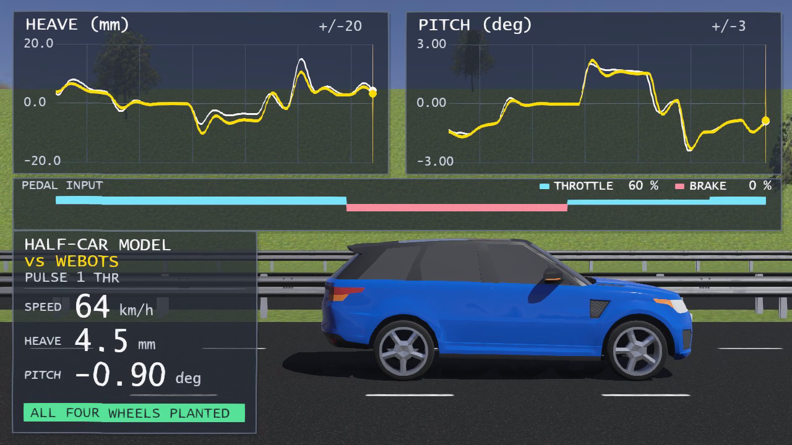

# Webots Longitudinal Dynamics

System identification of a vehicle's longitudinal and vertical dynamics from a Webots simulation.

This project demonstrates a differentiable, physics-grounded workflow for learning the parameters of a
vehicle dynamics model from trajectory data. Rather than fitting a black-box surrogate, we estimate the
parameters of a compact half-car model by solving its ODE and backpropagating through the trajectory with
automatic differentiation. The result is a model that is both interpretable and control-ready: grounded in
vehicle physics, optimized with modern SciML tooling, and useful for simulation, prediction, and digital-twin
applications.

A Range Rover Sport SVR (converted to electric drive) is driven along a straight highway by a scripted
throttle and brake schedule while a supervisor controller records roughly 140 channels — speed, position,
attitude, suspension heights, wheel contact, bounding boxes, pedal commands, and drive speed. The recorded
trace is then used to identify a simplified half-car model by differentiating through its ODE solution, and
the fitted model is drawn live over the simulator so the prediction and the measurement can be compared in
real time.

At a high level, the project follows the same recipe that makes differentiable physics and Neural ODEs
interesting: define a model, simulate it, compare to data, differentiate through the rollout, and optimize
the parameters until the trajectory matches. The difference is that this model is not a neural network — it
is an explicit half-car system with clear physical states and parameters. That gives the project a rare mix
of interpretability, scientific grounding, and modern optimization practice.

## Why this matters

This work sits at the intersection of classical vehicle dynamics, optimization, and scientific machine
learning. It shows how a traditional engineering model can be turned into a differentiable calibration
pipeline without sacrificing physical meaning.

- interpretable, compact model instead of a black-box surrogate
- gradients through the ODE trajectory rather than ad hoc finite-difference fitting
- direct parameter estimation from real dynamic measurements
- strong fit for control-oriented applications and model-based design
- a general workflow for any system where a mechanistic model exists but the parameters do not

The key use cases are immediate and practically relevant:

- model predictive control (MPC) for longitudinal motion, pitch regulation, and load-transfer-aware driving
- digital twins for vehicle behavior, diagnostics, and virtual prototyping
- calibration of traction, braking, and suspension parameters from test data
- controller synthesis and simulation-in-the-loop validation
- system identification pipelines that blend physics with data-driven optimization

The methodology also generalizes beyond this exact vehicle. If a system can be represented with a
state-space model and enough trajectory data exists, the same ODE-constrained optimization workflow applies.
On real-world data, the model structure, sensor assumptions, and noise handling may need to be tuned, but the
core idea remains unchanged: fit a physically meaningful model using differentiable simulation rather than
purely empirical curve fitting.

This project is intentionally aligned with the SciML philosophy: Julia, automatic differentiation, ODE
solvers, and optimization in one coherent workflow. It is a practical bridge between classical dynamics and
the modern machine-learning mindset of learning dynamics from data while keeping the model physically
grounded and interpretable.

<p align="center">
  
</p>

The panel shows heave and pitch against the recording, the pedal trace, and the current numbers. The
yellow traces are the Webots vehicle; the white traces are the fitted model integrated forward from the
measured state.

## What the model is

This is a compact differentiable dynamics model: a half-car system whose parameters are learned by fitting
the ODE trajectory to measured data. That is the heart of the project — not just a static vehicle model,
but a parameter-estimation workflow in the same family as modern differentiable simulation and Neural ODE
methodology.

A core design choice is that the model is intentionally built to be numerically smooth and easy to
differentiate. The drive, brake, and resistance terms are regularized with smooth functions such as tanh,
so the force law remains continuous and well-conditioned across the operating region. This matters because
it improves gradient flow through the ODE solution, stabilizes optimization, and helps the solver converge
reliably when fitting a physical model to trajectory data.

Ten states — heave, pitch, two unsprung heights, position, speed and their rates — with a longitudinal
force made of exactly three terms:

```
F = drive - brake_force - resistance
```

| term | law | why |
|---|---|---|
| **drive** | `smooth_min(throttle · throttle_force · T(rpm)/max_torque · redline, traction_acceleration · total_mass)` | the motor curve, capped by the vehicle library's wheel-spin guard |
| **brake** | `4 · brake_coefficient · brake_scale · brake / wheel_radius · tanh(v / brake_smoothing)` | a constant pad torque, because that is what the library applies |
| **resistance** | `resistance · |v| · tanh(v / resistance_smoothing)` | a single speed-proportional loss, measured from the coast |

Two of those came from reading the vehicle library's own source rather than guessing:

- **The drive is limited by wheel spin, not by torque.** `driver.c:52` defines
  `ACCELERATION_THRESHOLD 50 rad/s²` and scales the output torque down whenever the wheels spin up faster,
  so the car cannot pull harder than about `50 · 0.358 m = 17.9 m/s²` whatever the motor delivers. The
  recording confirms it: launch saturates near 1.9 g while the torque curve alone asks for 4.4 g.
- **The brake is a constant torque.** `driver.c:385` sets
  `damping_constant = |brake · brake_coefficient / ω|` precisely to cancel the speed dependence of its
  damping device, so the pad torque is set by the pedal alone at any road speed. The recorded deceleration
  is correspondingly flat in speed at a fixed pedal.

## Why this is close to modern ML, but still interpretable

This project follows the same high-level workflow that makes differentiable simulation and Neural ODEs
appealing:

- define a model with states and dynamics
- simulate a trajectory from the model
- compare that trajectory with data
- propagate gradients through the ODE solution
- optimize the parameters until the prediction matches the measurement

The difference is structural rather than conceptual. Here the model is not a learned black-box network; it is
a simple half-car system with a clear physical meaning. That makes the result more transparent, more
inspectable, and more suitable for engineering use. At the same time, it still benefits from the strengths
of the modern ML workflow: gradient-based optimization, data-driven calibration, and fast iteration over the
model structure.

This is also why the force laws are shaped to be differentiable by design. Smooth approximations such as tanh
and smooth_min keep the model well-behaved under automatic differentiation, which directly improves
optimization stability and convergence. In other words, the physics model is not just interpretable — it is
engineered to be a good target for differentiable fitting.

This is exactly why the workflow is relevant beyond simulation. The same approach applies to real vehicle data
as long as the model is tuned to the sensing setup, noise characteristics, and operating regime. In that sense,
this project sits in a powerful middle ground: a physically meaningful model, but optimized with the style and
rigor of modern differentiable learning.

## Results

Twenty-one estimated parameters, fit to the identification run and checked against a held-out run recorded
with the same event families at different values.

| | training | held out |
|---|---|---|
| objective | 8.80 | 7.65 |
| heave RMSE | 1.61 mm | 1.45 mm |
| pitch RMSE | 0.180° | 0.172° |
| speed RMSE | 1.91 km/h | 2.16 km/h |
| speed R² | 0.991 | 0.987 |

### Two things to know before trusting the masses

**The total mass is anchored, not identified.** Three free-mass fits landed at 2685, 2190 and 2822 kg
while all agreeing on `throttle_force / total_mass` to within 1 %: below the speed where the drive cap
binds, only that ratio is observable, so the optimiser can slide along the mass direction freely. Rather
than report whichever point it stopped at, the total is fixed at the vehicle proto's calibrated `2700 kg`
and the sprung mass follows from it.

**The unsprung masses are shared between axles, and that is an assumption.** Three free-split fits gave
front:rear ratios of 1.60, 0.97 and 3.82 — the last with a 10 kg rear wheel — so the split is not
identifiable either. One value is shared, and it settles at `49.1 kg per axle` (24.5 kg per wheel), which
is light for a 20-inch SUV wheel and tyre. It sits at 36 % of its box, so it is not a boundary artefact,
and it has no measurable effect on longitudinal prediction — but it is assumed, not measured.

## Requirements

| part | requirement |
|---|---|
| simulation | Webots R2025a, Python 3 (the `vehicle` module ships with Webots) |
| analysis | Julia 1.13; `analysis/Project.toml` and `analysis/Manifest.toml` pin the packages |
| large files | `git-lfs`, for the two datasets and the movie |

The stock Webots PROTOs the worlds reference (road, traffic, trees, backgrounds) are fetched over https at
load time, so only the custom vehicle PROTO travels with this repository.

## Reproducing it

### 1. Record the data

```powershell
webots --batch --mode=fast --stdout --stderr worlds/highway_overtake.wbt
```

That runs `controllers/longdyn_logger`, which applies `schedule_identification.json` and writes a CSV of
about 80 MB into `controllers/longdyn_logger/logs/`. Copy the result to `analysis/longdyn_train.csv`.
`worlds/highway_overtake_test.wbt` runs `schedule_validation.json` and produces the held-out set.

The two committed datasets were produced exactly this way; re-running will not reproduce them bit for bit
(ODE contact solving is not deterministic across builds), so treat them as the reference recordings.

A schedule is a JSON array of phases — `ramp`, `step`, `sine`, `pulse_train`, `sweep`, `regulate` and
similar macros that the controller expands and prints before the vehicle moves. Copy one, change the
levels, point `controllerArgs` at it.

### 2. Fit the model

```powershell
julia --project=analysis -e 'using Pkg; Pkg.instantiate()'
julia --project=analysis analysis/tools/run_parest.jl params_opt_v2.34.jl full 40
```

Or open `analysis/params_opt_v2.34.jl` in [Pluto](https://plutojl.org) and run it interactively — that is
the readable form, and the notebook explains each step. `run_parest.jl` is the same notebook replayed
headlessly, for when a fit takes twenty minutes and you do not want a browser in the loop.

Either way it writes `analysis/results/params-opt-v2.34.jld2`. To keep a variant beside the reference fit
instead of overwriting it, change `result_label` in the notebook's save cell — the comparison helpers
discover payloads by that label.

### 3. Export and check the port

```powershell
julia --project=analysis analysis/live/export_params.jl
python analysis/live/check_parity.py
```

The first writes `controllers/postopt_viewer/params_opt_v2.json` and two numerical fixtures from the
fitted payload. The second asserts that the Python re-implementation in the controller reproduces the
Julia right-hand side to 1e-10 and a full 2-second trajectory to 1e-9. Run both after **any** change to
the physics: a stale fixture is exactly the failure the check exists to surface.

There are two copies of the model — Julia for fitting, Python because a Webots controller has to compute
in-process to reach a `Display` device. The parity check is what keeps them honest; in this repository it
passes with **zero** error on every state component.

### 4. Render the movie

```powershell
webots --mode=realtime --stdout --stderr worlds/highway_overtake_postopt.wbt
```

About a minute of wall clock for 23 s of simulation. `--mode=realtime` is required: `--mode=fast` and
`--no-rendering` disable 3D rendering entirely, and the movie comes out as a still frame with a live panel
on top. Output goes to `media/`.

Then re-encode and extract the stills:

```powershell
ffmpeg -i media/postopt_raw.mp4 -c:v libx264 -preset slow -crf 19 -pix_fmt yuv420p `
    -vf "scale=in_range=full:out_range=tv" -colorspace bt709 -color_range tv `
    -movflags +faststart media/postopt_hud.mp4
```

`analysis/live/README.md` documents the pipeline in more detail, including the Webots rendering defects
this works around (a `Display` with a `Shape` child is drawn twice; the camera looks along local +X;
`drawText`'s y is the text's top, not its baseline).

## Checking the model against the simulator's own laws

```powershell
julia --project=analysis analysis/live/verify_webots_laws.jl
```

Evaluates three force laws algebraically, sample by sample, from the recorded pedals and rpm — no ODE, so
nothing integrates and nothing drifts — and compares each against the measured acceleration. It is the
check that keeps the fitted model honest: if the vehicle library's own laws describe the recording better
than the fit does, the fit is carrying something it should not.

The known weak point it reports: at the 4500 rpm limiter the model's `tanh` redline gives half torque
exactly where Webots hard-cuts to zero, so the algebraic comparison over-predicts drive there. The ODE
hides it because the model's own speed saturates first.

## Layout and file guide

```
repo root/
  README.md                     overview, requirements and reproduction steps
  LICENSE                       MIT licence for the code; Webots asset licence for proto/world files
  .gitattributes                LFS rules for the two CSVs, the JLD2 and the movie
  .gitignore                    ignore generated logs and the analysis outputs that are not checked in
  INIT_REPOSITORY.txt           repo setup notes and git commands to run once git is available

worlds/
  highway_overtake.wbt          identification run: logs the training signal
  highway_overtake_test.wbt     held-out validation run: same event families with different values
  highway_overtake_postopt.wbt  final overlay world that renders the model over the simulation
  forest/highway_overtake/     forest cache for the visual scene used in the final recording

protos/
  RangeRoverSportSVR_EV.proto  custom EV conversion of the Range Rover body/wheels used by the sim
  textures/                     body textures (plate + cosmetic detail maps)

controllers/
  longdyn_logger/
    longdyn_logger.py          drives the schedule, logs all vehicle channels and writes CSVs
    schedule_identification.json  training schedule used to excite the system
    schedule_validation.json    held-out schedule used to test generalisation
    docs/CSV_metadata.csv      header documentation for the logged CSV columns
  postopt_viewer/
    postopt_viewer.py          overlays the fitted model onto the live Webots scene and records it
    hud.py                     2D HUD drawing code for the plots, values and provenance text
    halfcar_model.py           Python port of the fitted half-car physics used by the controller
    params_opt_v2.json          exported fitted parameter set used by the live viewer
    schedule_postopt.json       final playback schedule for the movie render
    rhs_fixture.json            Julia-vs-Python derivative parity fixture
    trajectory_fixture.json     Julia-vs-Python trajectory parity fixture

analysis/
  Project.toml                 Julia project config for the identification workflow
  Manifest.toml                locked Julia package set for reproducible fitting
  params_opt_v2.34.jl          main Pluto notebook: model definition, fitting and diagnostics
  longdyn_train.csv            training data (LFS), the recorded identification run
  longdyn_test.csv             held-out validation data (LFS)
  tools/run_parest.jl          headless notebook runner for probe/full/validate modes
  live/
    export_params.jl           exports the fitted parameter set to the viewer JSON + parity fixtures
    check_parity.py            validates the Python model against the Julia right-hand side and RK4 step
    verify_webots_laws.jl      compares the fitted model and the vehicle-library laws against the data
    make_schedule.py           creates the final post-optimisation playback schedule
    audit_residuals.jl         residual analysis helper for checking fit quality by segment
    README.md                  detailed notes on the live render pipeline and the Webots quirks it works around
  results/
    params-opt-v2.34.jld2      stored fitted payload with parameter values and objective diagnostics

media/
  postopt_raw.mp4             raw Webots movie captured from the live render
  postopt_hud.mp4             final re-encoded delivery movie with better colour/compatibility
  postopt_hud.gif             animated preview used for quick review
  poster_t06.00.png           still from the run at 6.0 s
  poster_t14.40.png           still from the run at 14.4 s
  poster_t21.00.png           still from the run at 21.0 s
  hud_samples.csv             provenance log for the final HUD render (label, fit info, sample count)
```

The most important files to read first are:

- [analysis/params_opt_v2.34.jl](analysis/params_opt_v2.34.jl): the full fitted-model notebook and the source of truth for the dynamics model.
- [controllers/postopt_viewer/halfcar_model.py](controllers/postopt_viewer/halfcar_model.py): the Python port used by the live Webots viewer.
- [controllers/postopt_viewer/postopt_viewer.py](controllers/postopt_viewer/postopt_viewer.py): the controller that drives the live model and records the movie.
- [controllers/postopt_viewer/hud.py](controllers/postopt_viewer/hud.py): the 2D graphics overlay that renders the model against the recording.
- [analysis/live/check_parity.py](analysis/live/check_parity.py): the verification gate that keeps the Julia and Python models consistent.
- [analysis/live/export_params.jl](analysis/live/export_params.jl): writes the JSON and parity fixtures consumed by the viewer.

## Licence

MIT — see [LICENSE](LICENSE). The vehicle PROTO and the world are derived from Webots' own assets, which
are covered by the
[Webots assets licence](https://cyberbotics.com/webots_assets_license); the Range Rover model geometry
originates there.
